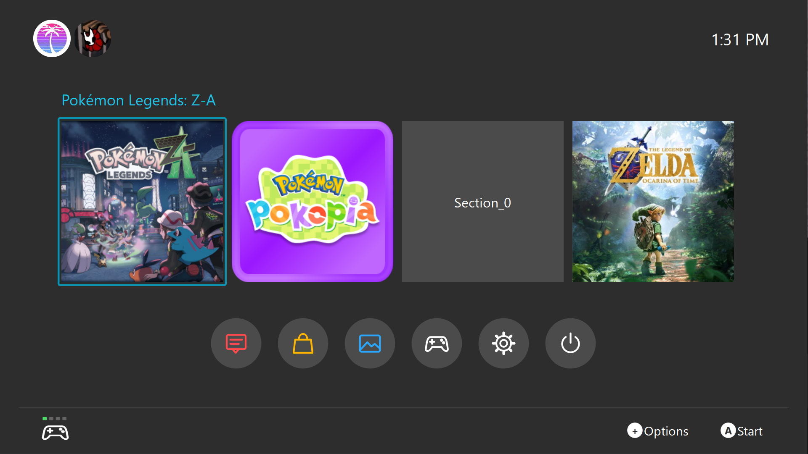

<!--
# SPDX-FileCopyrightText: Copyright 2025 Eden Emulator Project
# SPDX-License-Identifier: GPL-3.0-or-later

# SPDX-FileCopyrightText: 2018 yuzu Emulator Project
# SPDX-License-Identifier: GPL-2.0-or-later
-->

<p align="center">
  
</p>

# Lichii

Lichii is an experimental, open-source Nintendo Switch and Switch 2 emulator written in C++. It builds on Eglantine, Eden, yuzu and Sudachi, preserving their contributions while developing this fork's game compatibility and renderer fixes.

This is an independent fork, not an official release of those upstream projects. Lichii is not affiliated with Nintendo.

## About this fork (Lichii-GUI)

Lichii-GUI is a fork of [Lichii](https://github.com/zortos293/Lichii) that focuses on the desktop frontend. It keeps Lichii's emulator core and regularly merges its changes, and adds a home screen and settings modelled on the Switch HOME Menu.

<p align="center">
  
</p>

- **Home screen:** your profile pictures, a clock, a row of square game tiles with the selected title above it, round shortcut buttons (Handbook, Install Files, Album, Controllers, System Settings, Exit) and Options/Start hints. The most recently played game comes first.
- **Controller and keyboard navigation:** the D-pad or arrow keys move between the profiles, the game row and the shortcut buttons. A opens the highlighted item.
- **Settings in the same window:** without a running game, System Settings replaces the home screen instead of opening a new window. It can be used with a controller: L/R switch tabs, A changes a setting and B steps back. Backing out keeps your changes; **Discard Changes** cancels them.
- **Appearance:** Settings > Game List > Appearance offers Match System, Light, Dark or Classic. Light and Dark restyle the whole application. Classic keeps the previous desktop themes.
- **Cover art:** games without an icon, such as loose ExeFS/RomFS dumps, can show cover art. You can place a square `.png`/`.jpg` in the game's folder, choose one with **Cover Art** in the game's context menu, or turn on automatic downloads in Settings > Game List. Automatic downloads are off by default. When enabled, they send game names and title IDs to [switchiconshowdown.com](https://switchiconshowdown.com) and, if you add an API key, [SteamGridDB](https://www.steamgriddb.com).

The grid and list views remain available under **View > Game List Mode** and keep the regular desktop look.

## Downloads and setup

Published builds belong on this fork's [releases page](https://github.com/zortos293/Eglantine/releases). The repository still uses its historical Eglantine name; the desktop application is now Lichii.

On Windows, extract the entire build archive and run **lichii.exe**. Only use games and system files you have legally obtained. Games, keys and firmware are not included.

### Existing saves and settings

The rebrand intentionally retains the existing Eden/Eglantine data directories and configuration keys. It does not move or delete saves, settings or shader caches. Back up your saves before testing experimental builds.

## Compatibility and issue reports

Compatibility and performance vary by game, hardware and driver. Rendering errors, stutters and crashes remain possible. Passing automated tests does not establish that a game renders correctly, and this project makes no universal frame-rate guarantee.

When [reporting an issue](https://github.com/zortos293/Eglantine/issues), include:

- The exact build, game version, CPU, GPU and driver version.
- Relevant settings and steps to reproduce the problem.
- A screenshot and the log from the affected session, after checking it for personal information.

Do not upload game files, keys, firmware or private account information.

## Building from source

The steps below are for Windows with MSVC, which is how this fork is built and tested. For Linux, macOS, MSYS2, Android or clang-cl, follow the full [build guide](docs/Build.md) and [dependencies guide](docs/Deps.md).

Some inherited names remain. The GUI build target is still called `yuzu`, but it produces `lichii.exe`.

### Requirements

| Tool | Notes |
|---|---|
| [Visual Studio](https://visualstudio.microsoft.com/downloads/) 2022 or 2026 | Install the **Desktop development with C++** workload. |
| [CMake](https://cmake.org/download/) 3.31 or newer | It must be first on your `PATH` (see Troubleshooting). |
| [Ninja](https://ninja-build.org/) | Recommended build tool. |
| [Git for Windows](https://gitforwindows.org) | Also provides `patch.exe`, which the configure step uses on downloaded dependencies. |
| [Qt](https://www.qt.io/download-qt-installer-oss) 6.8.3, `msvc2022_64` | Select the **Qt Charts** add-on as well. |
| About 5 GB of free disk space | Covers Qt (about 2 GB), the downloaded dependencies and a Release build tree (under 1 GB each). Visual Studio needs its own space. |

You do not need the Vulkan SDK to compile; the configure step downloads the Vulkan headers. Instead of the Qt installer, you can install the same Qt with [aqtinstall](https://github.com/miurahr/aqtinstall):

```sh
pip install aqtinstall
aqt install-qt -O C:\Qt windows desktop 6.8.3 win64_msvc2022_64 -m qtcharts
```

### Build

Run these in PowerShell from the folder you cloned into. `load-msvc-env.ps1` loads the Visual C++ compiler into the current window. You can use the **x64 Native Tools Command Prompt for VS** instead.

```powershell
git clone https://github.com/Kipchun/Lichii-GUI.git
cd Lichii-GUI
.\tools\windows\load-msvc-env.ps1

cmake -S . -B build -G Ninja -DCMAKE_BUILD_TYPE=Release `
  -DCMAKE_C_COMPILER=cl -DCMAKE_CXX_COMPILER=cl `
  -DCMAKE_PREFIX_PATH="C:\Qt\6.8.3\msvc2022_64" -DYUZU_USE_BUNDLED_QT=OFF `
  -DYUZU_TESTS=OFF -DYUZU_CMD=OFF -DYUZU_ROOM=OFF

cmake --build build --target yuzu --parallel
```

The app is built at `build\bin\lichii.exe`, and the Qt libraries it needs are copied next to it. Change `CMAKE_PREFIX_PATH` if Qt is installed somewhere else.

The first configure downloads every dependency into `.cache\cpm` and takes a while. The first build compiles the whole emulator. After that, run `cmake --build build --target yuzu --parallel` again, and only changed files are rebuilt.

Useful options (see [docs/Options.md](docs/Options.md) and the root `CMakeLists.txt` for the rest):

| Option | Effect |
|---|---|
| `-DCMAKE_BUILD_TYPE=RelWithDebInfo` | Keeps debug symbols, so crashes can be symbolized. The executable is larger. |
| `-DYUZU_TESTS=ON` | Also builds the unit tests. |
| `-DYUZU_CMD=ON` | Also builds the command-line frontend. |
| `-DYUZU_USE_BUNDLED_QT=ON` | Has CMake download Qt for you instead of using your own installation. |

### Troubleshooting

- **`Could not find patch`, or a configure error inside another toolchain's folder:** a different `cmake` or `patch` is being found first. Tools from devkitPro or MSYS2 are common culprits. Put `C:\Program Files\CMake\bin` and `C:\Program Files\Git\usr\bin` at the front of `PATH` for that window.
- **`cl` is not recognized:** the Visual C++ environment isn't loaded in this window. Run `.\tools\windows\load-msvc-env.ps1` again.
- **Qt not found, or a missing `Qt6Charts`:** check `CMAKE_PREFIX_PATH`, and make sure the Qt Charts add-on is installed.
- **Strange configure errors after changing tools:** delete the `build` folder and configure again. `.cache` can stay.

## Contributing

See the [build guide](docs/Build.md), [user documentation](docs/user/README.md) and [coding guidelines](docs/Coding.md). Some inherited documentation still uses upstream names.

Keep changes focused and distinguish code-level checks from actual gameplay testing. Report problems with the home screen, settings or other frontend features on this fork's [issue tracker](https://github.com/Kipchun/Lichii-GUI/issues). Emulation bugs that also happen in Lichii belong upstream, as described above.

## Artwork
Art created by YOB (yobslab)
The supplied Lichii logo, icon and library artwork are in [dist/branding](dist/branding). Windows, Linux and macOS icon resources are generated from that artwork by [Generate-LichiiIcons.ps1](tools/Generate-LichiiIcons.ps1).

## Support Lichii

Lichii is free and stays free. If you want to help, you can donate in crypto. Donations help pay for the AI tools and build machines used to develop this open-source project faster.

**Solana (SOL)**
```text
JepEjfyWjGjhJvHSrqj52KtLjcbbbmUh1iGqerYBF4w
```

**Ethereum (ETH)**
```text
0x055ABa1b80Bc35C836Ce7E9F47c2b3d6C75b5534
```

**Bitcoin (BTC)**
```text
bc1qcvxdpf4qvdhqp8ee4s355cjmxrzsphsdwpl8w4
```

**BNB Smart Chain (BNB)**
```text
0x055ABa1b80Bc35C836Ce7E9F47c2b3d6C75b5534
```

**Polygon**
```text
0x055ABa1b80Bc35C836Ce7E9F47c2b3d6C75b5534
```

Send each coin on its matching network. Coins sent on the wrong network can't be recovered.

> [!NOTE]
> Donations are voluntary gifts and are non-refundable. A donation does not buy any product, service, perk, early access, exclusive build, priority support or say in the project. Every release stays free and public for everyone.

## Credits and license

Lichii inherits the work of the Eglantine, Eden, yuzu and Sudachi projects and their contributors, including Eglantine's original developer Camille LaVey. Original copyright notices and third-party licenses are retained.

See [LICENSE.txt](LICENSE.txt) and the source files for applicable license terms.
